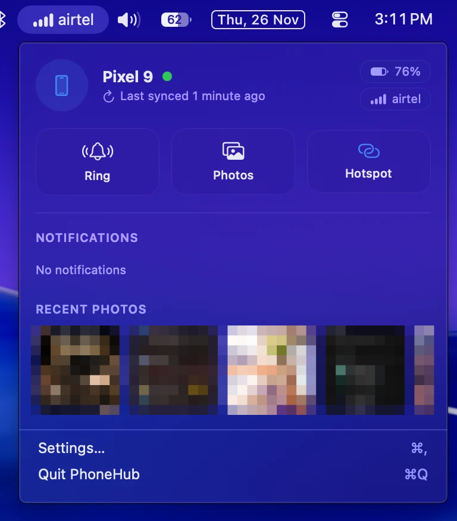
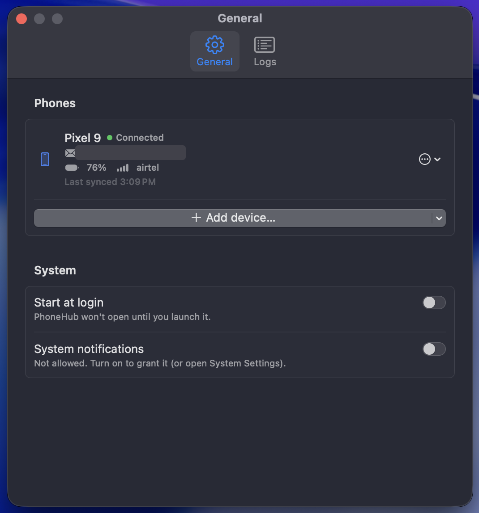

# phone-hub-macos

Make a Mac use an Android phone's **built-in** cross-device features — the ones a
Chromebook gets: one-tap hotspot (Instant Tethering), unlock with the phone
(Smart Lock), recent photos (Phone Hub camera roll) — with **no app on the
phone**. The phone already ships this; only the desktop side is missing.

This works by having the Mac enroll with Google as a Chrome device, the same way
a Chromebook does, then connecting to the phone over Bluetooth LE.

> Research project. Uses a throwaway Google account. It talks to a private Google
> service (CryptAuth) the way [microG](https://github.com/microg/GmsCore) does.

## Status

**The full Phone Hub link works, live, end to end — with no app on the phone.**
A SwiftUI menu-bar app (`swift/`) enrolls the Mac as a Chromebook, wakes the
phone's Nearby listener over BLE weave + D2D, opens the encrypted RFCOMM channel,
and streams **live phone status** (battery / signal / carrier), **camera-roll
photos**, **Instant Tethering** (turns on the hotspot and the Mac joins it), and
**ring**. The connection is stable once the weave session is torn down cleanly.

**The real wall is notifications — by Google's design, not ours.** GMS only ever
relays notifications you can *act on from a Chromebook*: replyable conversations
(a chat with an inline reply box) and live incoming calls. Bank/OTP SMS, missed
calls, promos, email, and app alerts are filtered out **on the phone** before
anything is sent — confirmed by decompiling GMS and reading its own debug logs. A
genuine Chromebook behaves identically.

Full technical record: **[docs/reverse-engineering.md](docs/reverse-engineering.md)**.

## The app

A menu-bar app shows live phone status, camera-roll photos, and one-tap hotspot;
Settings manages the paired phone and system permissions.

| Menu-bar panel | Settings |
| --- | --- |
|  |  |

Recent-photo thumbnails and the account email are blurred in these shots.

| Gate | What it proves | Result |
| --- | --- | --- |
| 1. Scope | the account can get the `cryptauth` OAuth scope | **passed** |
| 2. Enroll | Google accepts the Mac as `device_type = CHROME` | **passed** |
| 3. Enrolled | the device key is accepted (enrollKeys 200) | **passed** (server side) |
| 4. Registered | the Mac is in the Better Together registry (DeviceSync 200) | **passed** (as "Google eve") |

Gates 1 and 2 were the real unknowns. Both cleared with HTTP 200s. What remains
is ordinary engineering, documented in Chromium's source, not guesswork.

See [docs/protocol-and-test.md](docs/protocol-and-test.md) for the exact calls
and results, and [docs/overview.md](docs/overview.md) for why this path and not
Apple Continuity or KDE Connect.

## Layout

- `swift/` — the real client: `PhoneHubKit` (enrollment, BLE weave, D2D, Nearby /
  RFCOMM, phone_hub protocol) + `PhoneHubMenuBar` (the SwiftUI menu-bar app) +
  `phonehubkit-selftest` (the `bleweave` / `phonehub` CLIs the app spawns).
- `probe/` — the original Python feasibility probe (proved the server accepts the
  Mac). Superseded by the Swift client.
- `docs/` — findings and protocol notes; start with
  [docs/reverse-engineering.md](docs/reverse-engineering.md).

## Roadmap — done

1. ✅ **enrollKeys** — P-256 device key, signed enrollment; the phone lists the Mac.
2. ✅ **GCM registration + DeviceSync** — the Mac is in the Better Together registry.
3. ✅ **BLE weave + D2D** and **Nearby / RFCOMM** secure channels to the phone.
4. ✅ **Features** — phone status, camera roll, Instant Tethering, ring; reply /
   dismiss for relayed notifications.
5. ✅ **Native client** — SwiftUI menu-bar app.

What's left is not engineering: Phone Hub's notification filter (see the RE doc)
caps what notifications can ever be relayed. That's the stopping point.

## Credit

Protocol details read from microG (`GmsCore`) and the Chromium ChromeOS source
(`chromeos/ash/services/device_sync`, `chrome/browser/ash/cryptauth`).
